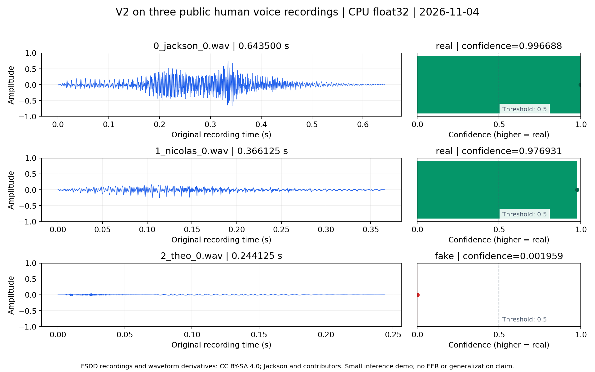

# Spectra Audio Deepfake Detection

用 Spectra-0 和 XLS-R 对本地音频批量评分，输出逐文件 CSV。V2 合并首、中、尾窗口的得分，模型资源准备好后可离线运行。

[安装与权重](examples/setup.md) · [复跑真实音频](examples/) · [查看实测 CSV](examples/real_audio/result.csv)

## 真实音频实跑（2026-11-04）

V2 在 CPU 上处理了 3 条公开 FSDD 人声。进程总耗时 16.29 秒，峰值内存约 3.69 GiB。模型将两条判为真实，一条误判为伪造。这组样本全是真实人声，仅用于演示推理流程。

[图文结果与复跑命令](examples/real_audio/RESULTS.md) · [输入与SHA256](examples/real_audio/inputs.json) · [真实CSV](examples/real_audio/result.csv) · [音频署名与许可](examples/real_audio/ATTRIBUTION.md)



按[安装指南](examples/setup.md)准备环境和 V2 权重后，在仓库根目录运行：

```bash
python examples/real_audio/fetch_inputs.py
mkdir -p output/public-demo
python predict.py examples/real_audio/input output/public-demo/result.csv \
  --config configs/v2.json --weights /path/to/v2_weights --device cpu
python examples/real_audio/verify_results.py output/public-demo/result.csv
```

输出文件与同名 `.state/` 必须不存在。示例 WAV 原字节采用CC BY-SA 4.0；项目MIT不重新授权音频。完整环境、预处理、分数语义和运行边界见图文报告。

## 配置与输出

- [V2](configs/v2.json) 使用[公开模型资源](configs/resources/v2.json)，适合复跑上面的示例。
- [Top2](configs/top2.json) 取伪造分数最高的两个窗口的均值。[DomainMoE](configs/domain_moe.json) 按声学域混合评分。两者依赖未公开的研究权重。

用自己的音频目录替换命令中的 `examples/real_audio/input` 即可批量处理。CSV 包含 `filename,label,confidence`。分数越高越偏向真实，高于 0.5 输出 `real`，其余输出 `fake`。分数未经概率校准。CLI 在所有输入处理成功后发布 CSV。

## 开发与许可

[predict.py](predict.py) 是命令行入口，[audio_spectra/](audio_spectra/) 实现解码、评分和输出。[无权重测试](examples/setup.md#本地检查)覆盖资源校验、CSV 输出和失败处理。

原创部分采用[MIT](LICENSE)，第三方来源与适用边界见[NOTICE](NOTICE)。上游Spectra模型卡的Apache-2.0/MIT标注存在未解决的不一致；本仓库不分发上游模型实现、权重、FFmpeg二进制或比赛原始资料；仅随真实推理示例分发明确署名的三条FSDD公开录音，也不以项目MIT重新授权这些资源。
