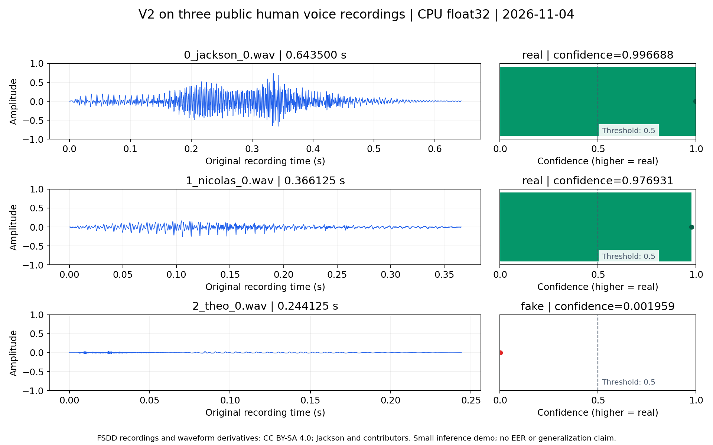

# 用三条公开人声跑通 Spectra V2：输入、命令、CSV 与误报实例

2026-11-04（北京时间） · `public_audio_demo_20261104_01` · Completed

本次按照公开 README 的 `predict.py` 入口和 `configs/v2.json`，实际加载 Spectra-0/XLS-R 权重，在 CPU 上处理了三条公开人声。三个文件全部完成，进程总耗时 **16.286 秒**，峰值常驻内存约 **3.693 GiB**。模型将两条判为 real，将一条语料来源为真实人声的录音判为 fake；全部结果原样保留。

这是一次可追踪的真实推理演示，验证范围是加载、解码、前向计算和 CSV 输出。它没有伪造音频对照，不能计算等错误率（Equal Error Rate，EER），也不能据此估计整体检测能力。



图左为原始录音的波形，未归一化幅度；图右为模型输出。confidence 越大越倾向 real，虚线为当前固定阈值 0.5。波形及其衍生图遵循下述 CC BY-SA 4.0 署名与许可。

## 输入：固定版本、原始字节、公开许可

样本来自 [Free Spoken Digit Dataset（FSDD）](https://github.com/Jakobovski/free-spoken-digit-dataset/tree/26eb9aaf76e81b692f806f9140c2d2777410d7a1)，作者为 Zohar Jackson 与 FSDD contributors。上游将其描述为人声数字录音，并采用 [CC BY-SA 4.0](https://creativecommons.org/licenses/by-sa/4.0/)；本次未修改 WAV 字节，也未使用比赛数据。输入在运行前固定，没有按预测结果筛选。

| 文件 / 可下载原始音频 | 口述数字 | 时长（秒） | 格式 | 字节数 |
|---|---:|---:|---|---:|
| [0_jackson_0.wav](https://raw.githubusercontent.com/Jakobovski/free-spoken-digit-dataset/26eb9aaf76e81b692f806f9140c2d2777410d7a1/recordings/0_jackson_0.wav) | 0 | 0.643500 | 8 kHz / 单声道 / PCM16 WAV | 10,340 |
| [1_nicolas_0.wav](https://raw.githubusercontent.com/Jakobovski/free-spoken-digit-dataset/26eb9aaf76e81b692f806f9140c2d2777410d7a1/recordings/1_nicolas_0.wav) | 1 | 0.366125 | 同上 | 5,902 |
| [2_theo_0.wav](https://raw.githubusercontent.com/Jakobovski/free-spoken-digit-dataset/26eb9aaf76e81b692f806f9140c2d2777410d7a1/recordings/2_theo_0.wav) | 2 | 0.244125 | 同上 | 3,950 |

固定 revision 为 `26eb9aaf76e81b692f806f9140c2d2777410d7a1`。逐文件 URL、SHA256、采样数及来源见 [inputs.json](https://github.com/pagee666-netizen/spectra-audio-deepfake-detection/blob/main/examples/real_audio/inputs.json)，署名见 [ATTRIBUTION.md](https://github.com/pagee666-netizen/spectra-audio-deepfake-detection/blob/main/examples/real_audio/ATTRIBUTION.md)。仓库内提供相同字节的三个 WAV；输入下载脚本也可从固定上游恢复并校验。

“真实人声”依据语料来源，不是本项目新增的法证鉴定标签。三位说话人的三个文件不构成训练/验证划分；未核查其与基础模型训练语料是否重叠。

## 复跑命令

以下命令从公开仓库根目录执行。先按 README 创建 Python 3.10 环境并安装依赖。推理使用现有 V2 资源；不在推理时联网。所有模型文件必须符合 `configs/resources/v2.json` 的 SHA256。

```bash
source .venv/bin/activate
python examples/real_audio/fetch_inputs.py

# 换成已准备好的 V2 权重目录，包含 spectra0/ 与 xlsr/。
V2_WEIGHTS=/path/to/v2_weights
mkdir -p output/public-demo
python predict.py examples/real_audio/input output/public-demo/result.csv \
  --config configs/v2.json --weights "$V2_WEIGHTS" --device cpu

python examples/real_audio/verify_results.py output/public-demo/result.csv
```

输出 CSV 和对应 `.state/` 必须尚不存在。再次运行应换一个新的输出路径。校验脚本检查列名、完整覆盖、唯一性、有限分数、标签方向，并与已发布分数比较，默认绝对容差 `1e-5`；这不是跨硬件浮点一致性的承诺。本轮只执行了一次真实模型推理，未声称多次运行逐位一致。

本机实际执行命令如下；`../../model/weights` 是本工作区已有的 V2 资源目录，读者用上面的 `V2_WEIGHTS` 替换即可：

```bash
.venv/bin/python predict.py examples/real_audio/input output/public-demo/result.csv \
  --config configs/v2.json --weights ../../model/weights --device cpu
```

V2 只使用上游基础资源，不依赖未公开的 F1-A、head 或 gate。如需自行准备权重，可在查阅上游许可后运行以下独立准备步骤，约下载 **2.54 GB**；本次运行复用了本地资源，没有执行这些模型下载。下载失败或散列不符须停止。

```bash
export V2_WEIGHTS=/path/to/v2_weights
python - <<'PY'
import hashlib, json, os, shutil, urllib.request
from pathlib import Path
root = Path(os.environ['V2_WEIGHTS'])
for item in json.loads(Path('configs/resources/v2.json').read_text()):
    path = root / item['path']
    path.parent.mkdir(parents=True, exist_ok=True)
    if not path.exists():
        filename = Path(item['path']).name
        url = f"https://huggingface.co/{item['repo']}/resolve/{item['revision']}/{filename}"
        partial = path.with_name(path.name + '.partial')
        with urllib.request.urlopen(url, timeout=120) as src, partial.open('xb') as dst:
            shutil.copyfileobj(src, dst)
        partial.rename(path)
    digest = hashlib.sha256()
    with path.open('rb') as stream:
        for block in iter(lambda: stream.read(1024 * 1024), b''):
            digest.update(block)
    if path.stat().st_size != item['bytes'] or digest.hexdigest() != item['sha256']:
        raise ValueError(f'Resource mismatch: {path}')
    print(item['path'], 'OK')
PY
```

资源定位与散列沿用已发布清单；未将该下载步骤作为本轮联网验证通过项。上游模型卡许可标注不一致的既有问题保留在 NOTICE；这里不重新分发模型或上游实现。

## 实测 CSV 与逐文件结果

[下载实际 result.csv](https://github.com/pagee666-netizen/spectra-audio-deepfake-detection/blob/main/examples/real_audio/result.csv)：

```csv
filename,label,confidence
0_jackson_0.wav,real,0.99668758767326893
1_nicolas_0.wav,real,0.97693063910664801
2_theo_0.wav,fake,0.0019589648987935354
```

CSV SHA256：`2f506a0fd5fb79b6677aab844899fa088c9e5879ae359a5dfa39a0bdfce3815b`。代码块展示内容；文件本身保留程序写出的 CRLF 行尾，计算散列请使用下载文件。

| 文件 | fake logit 差分 | confidence | 判决 | 解码至文件评分耗时（秒） |
|---|---:|---:|---|---:|
| 0_jackson_0.wav | -5.706761 | 0.996688 | real | 0.665327 |
| 1_nicolas_0.wav | -3.745910 | 0.976931 | real | 0.516723 |
| 2_theo_0.wav | 6.233378 | 0.001959 | fake | 0.544734 |

**第三条是应保留的误报实例。** 按语料的人声来源理解，它被当前模型与固定阈值判成 fake。它只有 0.244125 秒，图中幅度也较低；短时长、录音条件与重复补长可能影响模型，但本次没有消融实验，不能断言误报原因。不能把这个分数解释成“99.8% 确定为伪造”，也没有因误报调整阈值、反转分数或更换输入。

实际预处理为：8 kHz 重采样至 16 kHz、全波形预加重 `0.97`，短音频重复并截取至 64,600 个采样（4.0375 秒）。三个样本各产生一个窗口，因此本次没有验证长音频首/中/尾多窗口路径。文件分数为窗口 `spoof_logit - bonafide_logit` 的均值；`confidence = sigmoid(-fake_score)`，`confidence > 0.5` 判 real，否则 fake。模型计算使用 float32，差分均值与输出转换沿用现有实现。

## 环境、耗时与证据

| 项目 | 本次真实测量 / 实际配置 |
|---|---|
| 时间 | 2026-11-04 09:29:52–09:30:08（北京时间） |
| 设备 | Intel Xeon Platinum 8468；CPU；4线程；seed 42；未使用 GPU |
| Python / 系统 | Python 3.10.12；Linux x86_64；glibc 2.35 |
| 核心依赖 | torch/torchaudio 2.7.1+cu126、transformers 4.51.3、numpy 1.26.4、soundfile 0.13.1、safetensors 0.5.3 |
| 子进程退出码 / 状态 | 0 / Completed |
| CSV覆盖 / 解码失败 | 3/3，唯一文件名3；0/3失败；无缺失、重复或额外行 |
| 进程总耗时 | 16.286231 秒，含启动、导入、权重校验、加载、推理及输出；不含环境安装 |
| 引擎初始化 | 13.455985 秒，其中资源 SHA 校验2.113418秒、模型加载1.551501秒；这些分项已包含在初始化内 |
| 文件处理阶段 | 1.777845 秒；1.687436 文件/秒，不含初始化，不能外推至长录音 |
| 峰值常驻内存（RSS） | 3,965,181,952 字节，约3.693 GiB；进程自身高水位，不是系统总内存 |
| 模型加载 | 1次；Spectra严格加载718个张量，无缺失或多余键；XLS-R仅有预期的预训练专用额外头 |
| 既有接口测试 | 5项通过；测试中的桩评分不计入上述真实推理 |

原始文件级 logit、窗口散列和耗时见 [scores.jsonl](https://github.com/pagee666-netizen/spectra-audio-deepfake-detection/blob/main/examples/real_audio/scores.jsonl)。环境与完整依赖见 [environment.json](https://github.com/pagee666-netizen/spectra-audio-deepfake-detection/blob/main/examples/real_audio/environment.json)、[requirements-inference.txt](https://github.com/pagee666-netizen/spectra-audio-deepfake-detection/blob/main/examples/real_audio/requirements-inference.txt)。进程命令、状态和加载诊断见 [execution.json](https://github.com/pagee666-netizen/spectra-audio-deepfake-detection/blob/main/examples/real_audio/execution.json)，进度见 [inference.log](https://github.com/pagee666-netizen/spectra-audio-deepfake-detection/blob/main/examples/real_audio/inference.log)。公开状态文件仅将本机绝对输入/输出路径替换为仓库相对路径，原始状态保留在内部 run。

执行前核对了远端源码版本 `5d97d796788e735124c1aeb6fa98eab59dcf5799`，关键入口、模型适配、聚合、输出和配置共8个文件与本地逐字节一致；SHA256 见 [code_identity.json](https://github.com/pagee666-netizen/spectra-audio-deepfake-detection/blob/main/examples/real_audio/code_identity.json)。全部7项模型资源通过现有 SHA 清单检查，见 [weights_manifest.json](https://github.com/pagee666-netizen/spectra-audio-deepfake-detection/blob/main/examples/real_audio/weights_manifest.json)。本轮未更改推理算法。

本机依赖从保留的带哈希离线 wheel 恢复到项目 `.venv`。首次创建 venv 因缺少 ensurepip 失败，随后仅借用系统 pip 引导安装到该 venv；未升级系统环境。恢复后 `pip check` 通过。绘图在推理结束后单独安装 Matplotlib，不参与模型评分。若需重新生成插图：

```bash
python -m pip install -r examples/real_audio/requirements-figures.txt
python examples/real_audio/render_figures.py
```

## 验收与边界

| 验收项 | 结果与范围 |
|---|---|
| 文件归属与唯一正文 | 通过。内部正式正文在 reports；GitHub副本记录来源和散列，附件明确对应本实验。 |
| 原件与不可修改入口 | 通过。官方原件清单及生产 run.py 字节核验；未改模型、原件或历史结果。 |
| 索引、状态与导航 | 通过。本轮 run、报告与公开示例已登记。 |
| 静态与真实运行 | 通过。5项接口测试、输入SHA、真实CPU推理、CSV与logit映射核验；两者证据分开。 |
| GPU、真实rts、断网镜像、比赛平台 | 不适用。本次为公开 predict.py CPU演示；仅离线模型加载标志不等于操作系统断网验收。 |
| 异常与泛化边界 | 通过记录。保留环境首次失败与一条人声误报；未覆盖长音频、多声道、其他编码、静音、损坏文件；未计算EER。 |
| 外部发布范围 | 仅向用户已确认的GitHub仓库补充演示、README和许可说明；不上传权重、比赛数据、内部日志或凭据。发布提交与回读校验另存内部留档。 |

后续若要评价检测质量，应准备有可信双类标签、说话人与来源隔离的独立评估集，并固定分数方向与协议。本轮不自动进入训练、调参或比赛提交。
